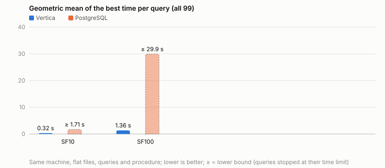
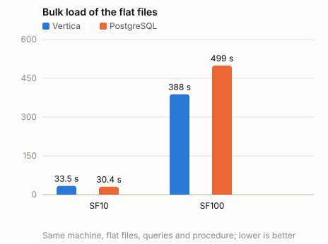
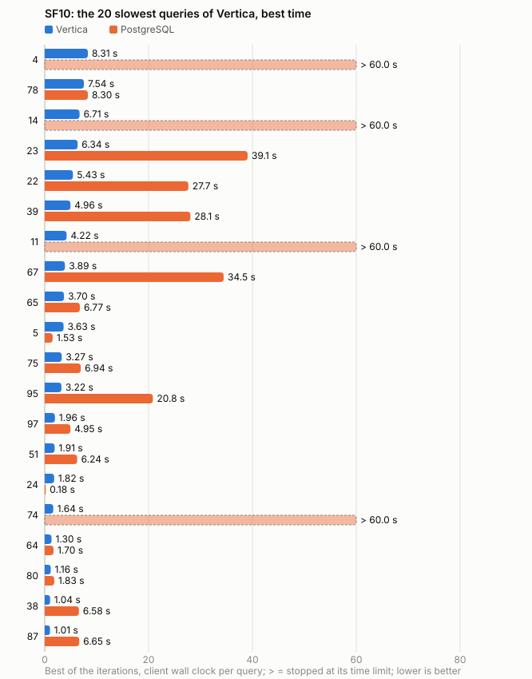
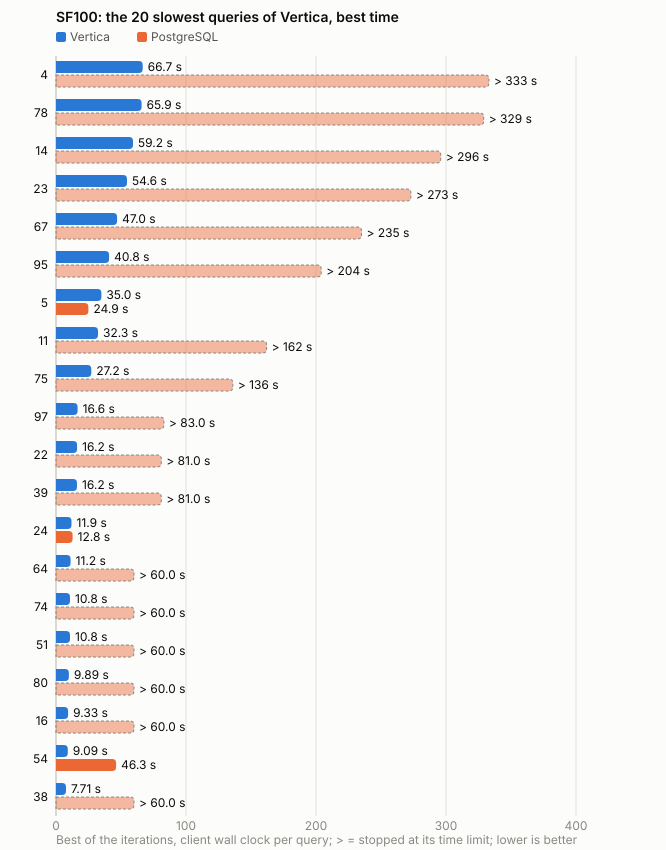

# TPC-DS comparison

Same toolkit, data, queries (`dsqgen -QUALIFY Y`), procedure and machine for every column; the settings of each run are in its results folder. Generated by `./tpcds.sh compare`; the analysis is in RESULTS.md. A query that did not finish within its time limit counts with its limit: totals marked ≥ are lower bounds, such a query shows as > limit.

| | Vertica SF10 | PostgreSQL SF10 | Vertica SF100 | PostgreSQL SF100 |
|---|---:|---:|---:|---:|
| Version | 26.3.0-2 | 18.6 (Ubuntu 18.6-1.pgdg26.04+2) | 26.3.0-2 | 18.6 (Ubuntu 18.6-1.pgdg26.04+2) |
| Deployment | Enterprise mode, 1 node(s) | single server, row store (heap tables) | Enterprise mode, 1 node(s) | single server, row store (heap tables) |
| Scale factor | 10 | 10 | 100 | 100 |
| Flat files | 12.0 GB | 12.0 GB | 102.5 GB | 102.5 GB |
| Stored in the database (all copies / indexes) | 4.1 GB | 22.2 GB | 39.2 GB | 147.5 GB |
| Compression (raw / stored) | 2.95x | 0.54x | 2.62x | 0.69x |
| Stored without indexes | 4.1 GB | 15.9 GB | 39.2 GB | 114.4 GB |
| Compression without indexes | 2.95x | 0.75x | 2.62x | 0.90x |
| Load time (COPY) | 33.5 s | 30.4 s | 388.1 s | 499.1 s |
| Load throughput | 358.7 MB/s | 394.4 MB/s | 264.0 MB/s | 205.3 MB/s |
| Primary keys and indexes | - | 63.2 s | - | 1098.6 s |
| Statistics | 3.5 s | 97.5 s | 11.4 s | 1845.0 s |
| Queries OK in all iterations | 99/99 | 91/99 | 99/99 | 31/99 |
| Queries not finished within the limit | 0 | 8 | 0 | 57 |
| Power run, best iteration | 94.4 s | ≥ 855.8 s | 663.8 s | ≥ 5841.9 s |
| Sum of the best time of each query | 92.9 s | ≥ 846.8 s | 659.8 s | ≥ 5641.0 s |
| Geometric mean of the best times | 0.323 s | ≥ 1.810 s | 1.361 s | ≥ 31.964 s |
| Queries under 1 s | 78 | 41 | 53 | 1 |
| Largest memory of one query | 19.2 GiB | - | 38.2 GiB | - |
| Spills per iteration (Vertica events / PostgreSQL temporary files) | 32 | 18 | 288 | 76 |
| Temporary file bytes per iteration | - | 9.9 GB | - | 55.2 GB |
| Iterations | 3 | 3 | 3 | 3 |
| Results folder | [20261031-0132_sf10_vertica_tuned](results/20261031-0132_sf10_vertica_tuned/summary.md) | [20261031-0145_sf10_postgresql_tuned](results/20261031-0145_sf10_postgresql_tuned/summary.md) | [20261031-0335_sf100_vertica_tuned](results/20261031-0335_sf100_vertica_tuned/summary.md) | [20261031-0506_sf100_postgresql_tuned](results/20261031-0506_sf100_postgresql_tuned/summary.md) |

## Settings

| | Vertica SF10 | PostgreSQL SF10 | Vertica SF100 | PostgreSQL SF100 |
|---|---|---|---|---|
| indexes | - | 36 indexes (24 primary keys), PG_INDEXES=yes | - | 36 indexes (24 primary keys), PG_INDEXES=yes |
| projections | 46 projections (24 super-projections), PROJECTIONS=designed | - | 41 projections (24 super-projections), PROJECTIONS=designed | - |
| resource pool | benchmark pool tpcds_pool: memorysize=65%, maxmemorysize=none, plannedconcurrency=2, executionparallelism=AUTO | - | benchmark pool tpcds_pool: memorysize=65%, maxmemorysize=none, plannedconcurrency=2, executionparallelism=AUTO | - |
| server settings | - | sql/postgresql/tuned.conf: default_statistics_target=1000, effective_cache_size=40GB, hash_mem_multiplier=2, jit=on, max_parallel_workers=22, max_parallel_workers_per_gather=16, random_page_cost=1.1, shared_buffers=10GB, work_mem=256MB | - | sql/postgresql/tuned.conf: default_statistics_target=1000, effective_cache_size=40GB, hash_mem_multiplier=2, jit=on, max_parallel_workers=22, max_parallel_workers_per_gather=16, random_page_cost=1.1, shared_buffers=10GB, work_mem=256MB |

## Hardware

| | Vertica SF10 | PostgreSQL SF10 | Vertica SF100 | PostgreSQL SF100 |
|---|---|---|---|---|
| Machine | Dell Inc. Precision 3591 (laptop) | Dell Inc. Precision 3591 (laptop) | Dell Inc. Precision 3591 (laptop) | Dell Inc. Precision 3591 (laptop) |
| CPU | Intel(R) Core(TM) Ultra 7 165H - 1 socket(s), 16 cores, 22 threads, max 5000 MHz, L3 24 MiB (1 instance) | Intel(R) Core(TM) Ultra 7 165H - 1 socket(s), 16 cores, 22 threads, max 5000 MHz, L3 24 MiB (1 instance) | Intel(R) Core(TM) Ultra 7 165H - 1 socket(s), 16 cores, 22 threads, max 5000 MHz, L3 24 MiB (1 instance) | Intel(R) Core(TM) Ultra 7 165H - 1 socket(s), 16 cores, 22 threads, max 5000 MHz, L3 24 MiB (1 instance) |
| Memory | 61.0 GiB RAM, 8.0 GiB swap | 61.0 GiB RAM, 8.0 GiB swap | 61.0 GiB RAM, 8.0 GiB swap | 61.0 GiB RAM, 8.0 GiB swap |
| Storage | 953.9G NVMe SSD (BC901 NVMe SK hynix 1024GB), ext4 | 953.9G NVMe SSD (BC901 NVMe SK hynix 1024GB), ext4 | 953.9G NVMe SSD (BC901 NVMe SK hynix 1024GB), ext4 | 953.9G NVMe SSD (BC901 NVMe SK hynix 1024GB), ext4 |
| OS | Ubuntu 26.04.1 LTS, kernel 7.0.0-34-generic | Ubuntu 26.04.1 LTS, kernel 7.0.0-34-generic | Ubuntu 26.04.1 LTS, kernel 7.0.0-34-generic | Ubuntu 26.04.1 LTS, kernel 7.0.0-34-generic |

## Charts

## Best time per query (seconds)

| Query | Vertica SF10 | PostgreSQL SF10 | Vertica SF100 | PostgreSQL SF100 |
|---:|---:|---:|---:|---:|
| 1 | 0.237 | > 60 | 1.674 | > 60 |
| 2 | 0.494 | 1.296 | 6.904 | 18.208 |
| 3 | 0.085 | 0.078 | 0.167 | 4.649 |
| 4 | 8.307 | > 60 | 66.691 | > 333 |
| 5 | 3.632 | 1.530 | 34.959 | 24.890 |
| 6 | 0.146 | > 60 | 0.405 | > 60 |
| 7 | 0.114 | 0.334 | 0.407 | 23.856 |
| 8 | 0.121 | 0.672 | 0.319 | > 60 |
| 9 | 0.242 | 4.183 | 0.870 | 50.830 |
| 10 | 0.218 | 7.525 | 1.678 | > 60 |
| 11 | 4.218 | > 60 | 32.340 | > 162 |
| 12 | 0.070 | 0.210 | 0.324 | 10.736 |
| 13 | 0.327 | 1.061 | 0.883 | > 60 |
| 14 | 6.707 | > 60 | 59.215 | > 296 |
| 15 | 0.175 | 1.774 | 1.030 | > 60 |
| 16 | 0.860 | 1.477 | 9.330 | > 60 |
| 17 | 0.879 | 2.051 | 4.586 | > 60 |
| 18 | 0.326 | 0.445 | 1.011 | 4.882 |
| 19 | 0.144 | 0.478 | 0.385 | > 60 |
| 20 | 0.098 | 0.363 | 0.401 | 2.304 |
| 21 | 0.138 | 2.085 | 0.391 | > 60 |
| 22 | 5.430 | 27.659 | 16.239 | > 81 |
| 23 | 6.340 | 39.076 | 54.640 | > 273 |
| 24 | 1.821 | 0.182 | 11.927 | 12.806 |
| 25 | 0.198 | 2.883 | 1.261 | > 60 |
| 26 | 0.106 | 0.295 | 0.314 | 14.517 |
| 27 | 0.175 | 3.764 | 0.404 | > 60 |
| 28 | 0.617 | 3.293 | 0.966 | 27.309 |
| 29 | 0.200 | 2.038 | 1.119 | > 60 |
| 30 | 0.158 | > 60 | 0.776 | > 60 |
| 31 | 0.695 | 16.251 | 5.507 | 27.575 |
| 32 | 0.050 | 0.277 | 0.148 | 24.085 |
| 33 | 0.150 | 0.915 | 0.439 | > 60 |
| 34 | 0.115 | 0.697 | 0.653 | 30.631 |
| 35 | 0.635 | 5.729 | 3.992 | > 60 |
| 36 | 0.227 | 3.615 | 0.890 | > 60 |
| 37 | 0.123 | 0.090 | 0.553 | 1.216 |
| 38 | 1.038 | 6.581 | 7.713 | > 60 |
| 39 | 4.957 | 28.061 | 16.179 | > 81 |
| 40 | 0.328 | 0.449 | 2.465 | > 60 |
| 41 | 0.054 | 18.766 | 0.109 | > 60 |
| 42 | 0.067 | 0.434 | 0.082 | 18.368 |
| 43 | 0.095 | 1.185 | 0.303 | > 60 |
| 44 | 0.087 | 0.732 | 0.311 | 13.586 |
| 45 | 0.144 | 3.444 | 1.093 | > 60 |
| 46 | 0.345 | 1.747 | 1.318 | > 60 |
| 47 | 0.954 | 13.079 | 3.040 | > 60 |
| 48 | 0.352 | 1.893 | 1.186 | > 60 |
| 49 | 0.180 | 0.382 | 0.526 | 14.000 |
| 50 | 0.219 | 0.358 | 2.174 | 40.927 |
| 51 | 1.908 | 6.244 | 10.765 | > 60 |
| 52 | 0.073 | 0.434 | 0.108 | 13.229 |
| 53 | 0.073 | 0.687 | 0.219 | 13.055 |
| 54 | 0.594 | 0.248 | 9.090 | 46.260 |
| 55 | 0.083 | 0.302 | 0.099 | 15.448 |
| 56 | 0.128 | 1.083 | 0.279 | > 60 |
| 57 | 0.649 | 7.092 | 1.801 | > 60 |
| 58 | 0.135 | 0.276 | 0.342 | 8.316 |
| 59 | 0.461 | 2.366 | 2.938 | 13.051 |
| 60 | 0.168 | 3.995 | 0.576 | > 60 |
| 61 | 0.077 | 0.130 | 0.101 | 1.090 |
| 62 | 0.448 | 0.493 | 0.548 | 5.984 |
| 63 | 0.075 | 0.682 | 0.217 | 23.104 |
| 64 | 1.304 | 1.696 | 11.232 | > 60 |
| 65 | 3.703 | 6.769 | 6.421 | > 60 |
| 66 | 0.307 | 1.122 | 0.734 | > 60 |
| 67 | 3.893 | 34.458 | 47.004 | > 235 |
| 68 | 0.195 | 0.437 | 0.530 | 45.376 |
| 69 | 0.111 | 1.410 | 0.506 | > 60 |
| 70 | 0.157 | 3.420 | 0.307 | > 60 |
| 71 | 0.159 | 0.905 | 0.739 | > 60 |
| 72 | 0.745 | 1.886 | 4.277 | > 60 |
| 73 | 0.087 | 0.301 | 0.222 | 6.830 |
| 74 | 1.640 | > 60 | 10.801 | > 60 |
| 75 | 3.274 | 6.940 | 27.169 | > 136 |
| 76 | 0.305 | 15.065 | 1.947 | > 60 |
| 77 | 0.183 | 0.792 | 0.511 | > 60 |
| 78 | 7.541 | 8.302 | 65.857 | > 329 |
| 79 | 0.217 | 1.113 | 1.902 | > 60 |
| 80 | 1.156 | 1.829 | 9.890 | > 60 |
| 81 | 0.196 | > 60 | 0.956 | > 60 |
| 82 | 0.133 | 0.148 | 0.833 | 3.300 |
| 83 | 0.116 | 0.214 | 0.327 | 10.879 |
| 84 | 0.158 | 0.146 | 0.329 | 1.458 |
| 85 | 1.008 | 0.316 | 2.973 | 5.294 |
| 86 | 0.121 | 1.404 | 0.432 | > 60 |
| 87 | 1.010 | 6.649 | 7.651 | > 60 |
| 88 | 0.349 | 3.748 | 0.863 | 34.166 |
| 89 | 0.131 | 1.522 | 0.386 | > 60 |
| 90 | 0.053 | 0.404 | 0.381 | 4.797 |
| 91 | 0.080 | 0.163 | 0.130 | 0.530 |
| 92 | 0.056 | 0.191 | 0.127 | 2.649 |
| 93 | 0.173 | 0.274 | 2.461 | 12.169 |
| 94 | 0.479 | 3.656 | 5.743 | > 60 |
| 95 | 3.222 | 20.827 | 40.816 | > 204 |
| 96 | 0.060 | 0.606 | 0.183 | 15.244 |
| 97 | 1.963 | 4.949 | 16.598 | > 83 |
| 98 | 0.177 | 0.725 | 0.296 | 4.699 |
| 99 | 0.198 | 0.935 | 0.903 | 14.951 |
