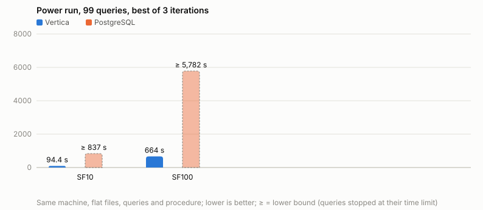
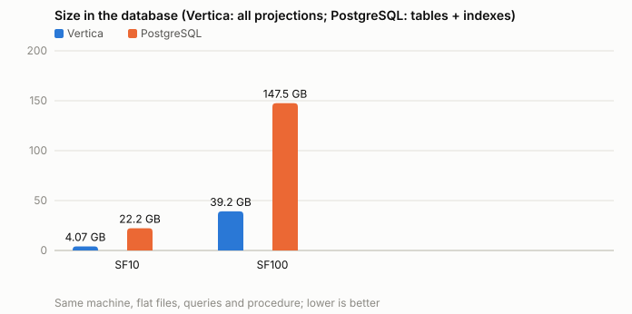

# Results: TPC-DS on Vertica 26.3 and PostgreSQL 18.6

Measured on 2026-10-31 on one machine, both products with the same data, queries
and procedure (rules in [README.md](README.md#rules-of-the-comparison)). Side-by-side
tables of every metric and the best time of each query: [COMPARISON.md](COMPARISON.md).
Query plans behind the biggest differences: [analysis/](analysis/README.md).

## Test machine

| | |
|---|---|
| Machine | Dell Precision 3591 laptop, on AC power, lid closed |
| CPU | Intel Core Ultra 7 165H: 16 cores (6 performance, 8 efficient, 2 low-power), 22 threads, max 5.0 GHz, 24 MiB L3 |
| Memory | 64 GB (61 GiB usable), 8 GiB swap |
| Storage | 1 TB NVMe SSD (SK hynix BC901), ext4; Vertica data and PostgreSQL data on two partitions of it |
| OS | Ubuntu 26.04.1 LTS, kernel 7.0; CPU governor performance, readahead 1 MiB, swappiness 1 (`scripts/tune_os.sh`) |
| Vertica | 26.3.0-2 Community Edition, Enterprise mode, 1 node; resource pool for the queries: 65% of RAM, planned concurrency 2; projections by Database Designer (SF10: 46, SF100: 41) |
| PostgreSQL | 18.6 (PostgreSQL apt repository), [sql/postgresql/tuned.conf](sql/postgresql/tuned.conf): shared_buffers 10 GB, work_mem 256 MB, effective_cache_size 40 GB, up to 16 parallel workers per query (22 in total), JIT on, random_page_cost 1.1, statistics target 1000; 24 primary keys + 12 indexes ([sql/postgresql/indexes.sql](sql/postgresql/indexes.sql)) |
| Workload | TPC-DS toolkit (dsdgen / dsqgen, pinned commit), 24 tables, 99 queries with the qualification parameters; scale factors 10 and 100 |

## Summary

| | Vertica SF10 | PostgreSQL SF10 | Vertica SF100 | PostgreSQL SF100 |
|---|---:|---:|---:|---:|
| Flat files | 12.0 GB | 12.0 GB | 102.5 GB | 102.5 GB |
| Size in the database | **4.1 GB** | **22.2 GB** | **39.2 GB** | **147.5 GB** |
| of which indexes | - | 6.3 GB | - | 33.1 GB |
| Compression (flat files / database) | 2.95x | 0.54x (0.75x without indexes) | 2.62x | 0.69x (0.90x without indexes) |
| COPY | 33 s | 30 s | 388 s | 499 s |
| Primary keys and indexes | - | 63 s | - | 1,099 s |
| Statistics | 3.5 s | 98 s (VACUUM FREEZE, ANALYZE) | 11 s | 1,845 s (VACUUM FREEZE, ANALYZE) |
| **99 queries, best iteration** | **94 s** | **≥ 837 s** | **664 s** | **≥ 5,782 s** |
| Sum of the best time of each query | 93 s | ≥ 828 s | 660 s | ≥ 5,581 s |
| Geometric mean of the best times | 0.32 s | ≥ 1.71 s | 1.36 s | ≥ 29.93 s |
| Queries finished within their limit | 99 | 91 | 99 | 43 |
| Queries under 1 s | 78 | 42 | 53 | 2 |
| Spills to disk per iteration | 32 events | 18 temporary files, 9.9 GB | 288 events | 76 temporary files, 55.2 GB |

Every PostgreSQL total contains queries that were stopped at their time limit and are
counted with that limit, so the real totals are higher (`≥`).

## Time limits and queries that did not finish

PostgreSQL limit per query = `max(60 s, 5 x Vertica's best time for the query at the same
scale factor)`. A query over its limit was stopped (client ended, server session
terminated) and not run again in the later iterations.

- **SF10:** all limits are 60 s (Vertica's slowest query took 8.3 s). 8 queries did not
  finish: 1, 4, 6, 11, 14, 30, 74, 81. Run once more with a 10-minute limit each
  (`results/20261031-0212_sf10_postgresql_rerun-600s`):

  | Query | Vertica best | PostgreSQL, 10-minute limit |
  |---:|---:|---:|
  | 14 | 6.71 s | 120.9 s |
  | 81 | 0.20 s | 387.7 s |
  | 30 | 0.16 s | 579.6 s |
  | 1 | 0.24 s | > 600 s |
  | 4 | 8.31 s | > 600 s |
  | 6 | 0.15 s | > 600 s |
  | 11 | 4.22 s | > 600 s |
  | 74 | 1.64 s | > 600 s |

- **SF100:** limits from 60 s to 333 s (12 queries above 60 s). 56 queries did not finish
  within their limit; Vertica needed 567 s of its 660 s for these 56 queries (median
  1.7 s per query). Eight queries that finished in iteration 1 (in 23-51 s) went over
  their 60 s limit in iteration 2: at 147 GB the PostgreSQL data does not fit into the
  61 GiB of memory, so a query's time depends on what the previous queries left in the
  page cache. The best of the iterations counts, so their iteration-1 times are the
  result.

## What the time limits mean

A time limit stops a query; it does not measure it. "> 60 s" or "> 600 s" means *at
least* that long, and how much longer is unknown - it may be minutes more, hours more, or
practically never. So every PostgreSQL total marked `≥` is a floor, and the ratio of a
stopped query (limit / Vertica time) is a minimum, not an estimate. How far below the
real figure the floor can be is shown by the measurements below.

**1. The worst ratio of a query that finished.** Query 30 at SF10 (customers whose web
returns are 20% above the average of their state): in the power run it was stopped at
60 s, which shows only as "> 380x". With the 10-minute limit it finished: **579.6 s on
PostgreSQL against 0.158 s on Vertica, 3,668x** - ten times the floor the 60 s limit had
shown. Query 81 (the same pattern for catalog returns): 387.7 s against 0.196 s, 1,978x
instead of "> 306x".

**2. These queries grow with the square of the data - measured, and visible in the
plan.** From SF1 to SF10 (ten times the data) query 30 went from 6.25 s to 579.6 s on
PostgreSQL (**93x**), query 81 from 4.89 s to 387.7 s (79x); Vertica: 0.067 -> 0.158 s
(2.4x) and 0.075 -> 0.196 s (2.6x). The PostgreSQL plan explains it: the correlated
subquery is a SubPlan that runs once for every row of the `customer_total_return` CTE and
scans the whole CTE each time, so the work is rows x rows. The SF100 plan of query 30
([analysis/postgresql_plans_sf100/q30.plan](analysis/postgresql_plans_sf100/q30.plan)) is
the same SubPlan over ten times the CTE rows (estimated 32,803 against 3,276 at SF10).
Queries 1 and 6 have the same pattern; at SF1 they already took 89 s and 48 s.

**3. What that means at SF100.** With the growth measured from SF1 to SF10, query 30
would need about 579.6 s x 93 = **54,000 s, roughly 15 hours**, at SF100 - against
0.78 s on Vertica, about 70,000x. This is an extrapolation, not a measurement; it rests
on the measured growth and on the plan, which stays the same.

**4. The test: query 30 at SF100 with a 30-minute limit**
([results/20261031-1010_sf100_postgresql_q30-1800s](results/20261031-1010_sf100_postgresql_q30-1800s/summary.md)):
**stopped after 30 minutes, not finished**, as the estimate predicts. At SF100 query 30
therefore takes more than 1,800 s / 0.776 s = **2,300x** Vertica's time, where the 60 s
limit of the power run had shown only "> 77x".

**What follows.** For the queries with this pattern (1, 6, 30, 81) the limits hide
differences of thousands of times at SF10 and far more at SF100, where the real run time
is hours. Not every stopped query is of this kind: at SF100 most of the 56 queries over
their limit are large scans and joins whose data no longer fits in memory (eight of them
finished in 23-51 s in iteration 1 and went over 60 s in iteration 2); their real times
are likely minutes rather than hours. Either way the published PostgreSQL totals are
lower bounds, and the true gap is larger than the tables show.

## Where PostgreSQL is close, and where it is not

Queries both products finished, PostgreSQL time / Vertica time (best of 3):

| | SF10 (91 queries) | SF100 (43 queries) |
|---|---:|---:|
| PostgreSQL as fast or faster | 7 (3, 5, 24, 37, 54, 84, 85) | 2 (5, 41) |
| within 2x | 21 | 4 |
| within 5x | 44 | 12 |
| within 10x | 70 | 15 |
| 10x or more | 21 | 28 |
| median ratio | 5.1x | 20.9x |

- **PostgreSQL's strength: selective index lookups.** Query 5 reads a 14-day window
  through the date indexes and is faster on PostgreSQL at both scale factors (SF100:
  24.9 s vs 35.0 s); query 24 goes from a few stores' customers through two indexes
  (SF10: 0.18 s vs 1.82 s; SF100: 12.8 s vs 11.9 s).
- **PostgreSQL's weakness: correlated subqueries and repeated CTEs.** Queries 1, 6, 30
  and 81 run a subquery once per row (a SubPlan) where Vertica computes it once as a
  join; queries 4, 11 and 74 join a large CTE to itself through nested loops. These
  queries take 0.15-8 s on Vertica and minutes or more on PostgreSQL. Plans:
  [analysis/](analysis/README.md).
- **Scaling.** From SF10 to SF100 (10x the data) Vertica's total time grew 7.0x. On the
  43 queries PostgreSQL finished at both scale factors, its time grew 14.6x (Vertica on
  the same queries: 6.6x). At SF10 both data sets fit into memory; at SF100 Vertica's
  39 GB still nearly does, PostgreSQL's 147 GB does not, and PostgreSQL wrote 55 GB of
  temporary files per iteration.

## Storage

The size difference is the base of the query difference: every scan reads the stored
size. At SF100 `store_sales` takes 40.7 GB as flat files, 18.2 GB in Vertica (all
projections) and 52.9 GB in PostgreSQL (42.4 GB table + 10.5 GB indexes). `inventory`
(399 million rows of 4 integer columns at SF100) takes 8.2 GB as flat files, 0.69 GB in
Vertica and 30.3 GB in PostgreSQL (17.7 GB table + 12.6 GB primary key): a PostgreSQL
row carries a header of about 24 bytes plus a 4-byte line pointer, more than its four
values, while Vertica stores the columns sorted, run-length encoded and compressed.

## Answer check

At SF1 (before the runs) and again at SF10 the result rows of both products were
compared (`./tpcds.sh verify`). At SF10, of the 91 queries both finished in the power
run, 83 return identical rows, 5 the same rows in another order (ties in `ORDER BY`),
queries 77 and 93 differ only in which rows reach the `LIMIT` (NULLs sort first in
Vertica and last in PostgreSQL), and query 17 shows NaN in Vertica and NULL in
PostgreSQL for the standard deviation of a single value; the row counts of the three
queries that finished in the 10-minute rerun (14, 30, 81) match as well. Five queries needed a cast
in PostgreSQL to compute the same answer (integer division, see
[README.md](README.md#query-changes)).

## Query 41: identical text for both products

Vertica cannot run the correlated `count(*)` subquery of query 41 and runs the
equivalent `EXISTS` text. PostgreSQL first ran the original text (18.8 s at SF10, over
its 60 s limit at SF100); with the `EXISTS` text it plans a hash semi-join instead of a
SubPlan per row ([analysis/](analysis/README.md#query-41-the-same-meaning-two-texts)). So
that both products answer identical SQL, query 41 was run again on PostgreSQL with
Vertica's text (3 iterations, same limits: `results/20261031-1009_sf10_postgresql_q41-exists`,
`results/20261031-1010_sf100_postgresql_q41-exists`), and these rows replace query 41 in
the PostgreSQL power runs (`./tpcds.sh amend`; the original rows are kept in
`timings_original.csv`, the change is described in `amended.md` of each run). Query 41,
best of 3: Vertica 0.054 s / 0.109 s, PostgreSQL 0.066 s / 0.089 s (SF10 / SF100); the
rows match Vertica's.

## Results folders

| Run | Folder |
|---|---|
| Vertica SF10 | [results/20261031-0132_sf10_vertica_tuned](results/20261031-0132_sf10_vertica_tuned/summary.md) |
| PostgreSQL SF10 | [results/20261031-0145_sf10_postgresql_tuned](results/20261031-0145_sf10_postgresql_tuned/summary.md) |
| PostgreSQL SF10, 10-minute rerun | [results/20261031-0212_sf10_postgresql_rerun-600s](results/20261031-0212_sf10_postgresql_rerun-600s/summary.md) |
| PostgreSQL query 41 with the identical text (SF10, SF100) | [results/20261031-1009_sf10_postgresql_q41-exists](results/20261031-1009_sf10_postgresql_q41-exists/summary.md), [results/20261031-1010_sf100_postgresql_q41-exists](results/20261031-1010_sf100_postgresql_q41-exists/summary.md) |
| PostgreSQL query 30 at SF100, 30-minute limit | [results/20261031-1010_sf100_postgresql_q30-1800s](results/20261031-1010_sf100_postgresql_q30-1800s/summary.md) |
| Vertica SF100 | [results/20261031-0335_sf100_vertica_tuned](results/20261031-0335_sf100_vertica_tuned/summary.md) |
| PostgreSQL SF100 | [results/20261031-0506_sf100_postgresql_tuned](results/20261031-0506_sf100_postgresql_tuned/summary.md) |
| SF1 smoke tests (answer check) | `results/20261031-0054_sf1_vertica_smoke`, `results/20261031-0106_sf1_postgresql_smoke`, `results/20261031-0126_sf1_postgresql_smoke-division` |

Each folder: `timings.csv` (every query of every iteration), `summary.md`, `metrics.csv`,
`environment.md`, `load.csv` / `load.info` / `generate.info`, `budgets.csv` (PostgreSQL),
and the monitoring data saved at run time (Vertica: `query_requests.csv`,
`query_events.csv`, `projection_storage.csv`; PostgreSQL: `server_log.csv`,
`settings.csv`, `relation_sizes.csv`).
